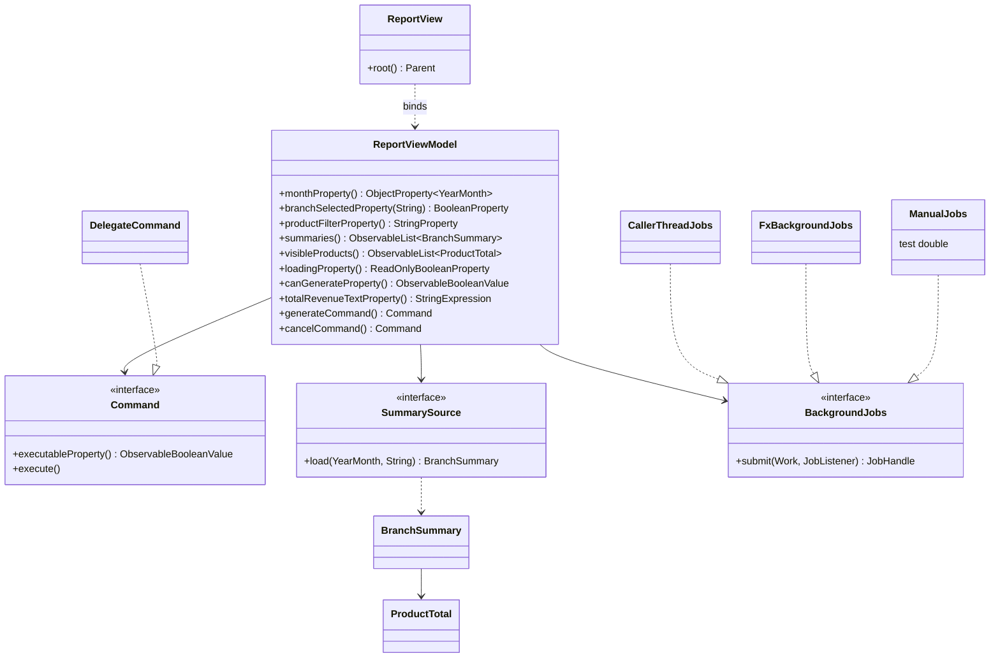
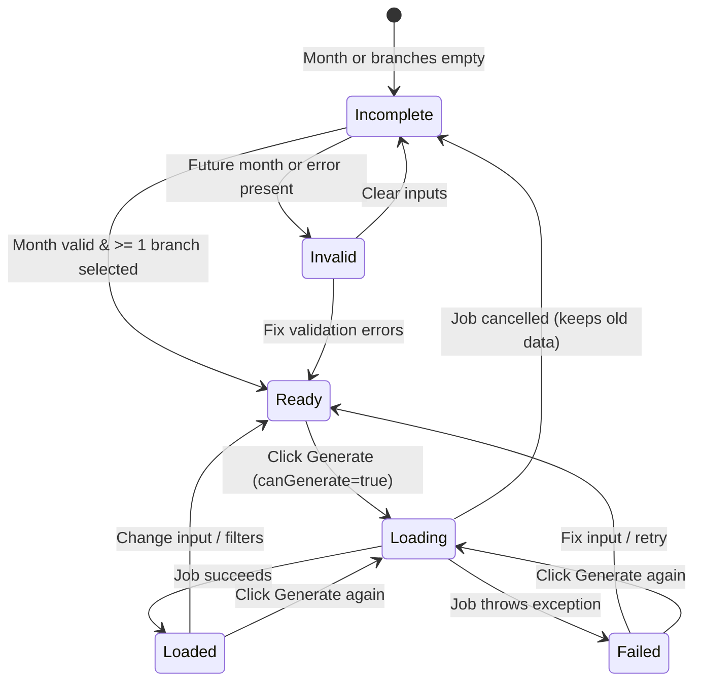

# Lab-03 ViewModel design

## 1. Controller inventory (Lab-02 `ReportController`)

| # | Code in Lab-02 | Concern | New owner |
|---|----------------|---------|-----------|
| 1 | `monthEntered(String text)` reads the typed month | Text to `YearMonth` conversion | View (`YearMonthConverter`) |
| 2 | `InputRules.month(text, clock)` (future month rule) | Validation | ViewModel (`monthError`) |
| 3 | `case Valid(var month) -> execute(new LoadMonth(month))` | Start a load | ViewModel (`generateCommand`) |
| 4 | `case Invalid(var message) -> errors.showError(message)` | Show validation message | ViewModel (`validationMessage`), View decides the look |
| 5 | `branchChosen(String text)` and `InputRules.branch(text)` | Branch input and rule | ViewModel (`branchSelected(b)`, `branchError`) |
| 6 | `case SelectBranch(var branch) -> model.selectBranch(branch)` | Which branches are shown | ViewModel (`selectedBranches()`, `summaries`) |
| 7 | `model.load(dataDir, month)` | Read CSV and summarize | Model (behind `SummarySource`), run via `BackgroundJobs` |
| 8 | `catch (NoSuchFileException e)` "No sales data found in ..." | Load error state | ViewModel (`loadError`, `status`) |
| 9 | `catch (IOException e)` "Could not read the sales files: ..." | Load error state | ViewModel (`loadError`, `status`) |
| 10 | `errors.clearError()` after success | Reset error | ViewModel (`loadError`) |
| 11 | `Clock clock` field | Time source for the month rule | ViewModel (injected `Clock`) |
| 12 | `Path dataDir` field and `ErrorDisplay errors` field | Data location / error label | `dataDir`: composition root (`ReportViewerApp`). `errors`: View (label bound to `loadError`) |

## 2. ViewModel members

| Member | Group | View may write? |
|--------|-------|-----------------|
| `month` | input | yes (two-way) |
| `branchSelected(b)` | input | yes (two-way) |
| `productFilter` | input | yes (two-way) |
| `monthChoices` | output | no |
| `summaries` | output | no |
| `visibleProducts` | output | no |
| `loading` | output | no |
| `progress` | output | no |
| `status` | output | no |
| `loadError` | output | no |
| `monthError` | computed | no |
| `branchError` | computed | no |
| `validationMessage` | computed | no |
| `canGenerate` | computed | no |
| `totalRevenue` | computed | no |
| `totalRevenueText` | computed | no |
| `generateCommand` | command | execute only |
| `cancelCommand` | command | execute only |

## 3. Class diagram

## 4. Screen State Machine

### State Property Values Reference
* **Incomplete**: `monthError` or `branchError` active (e.g., `"Choose a month."`), `canGenerate = false`, `loading = false`.
* **Invalid**: `monthError` active (e.g., future month error), `canGenerate = false`, `loading = false`.
* **Ready**: `monthError` & `branchError` both empty (`""`), `canGenerate = true`, `loading = false`.
* **Loading**: `loading = true`, `canGenerate = false`, `cancelCommand` executable.
* **Loaded**: `loading = false`, data tables populated successfully, previous errors cleared.
* **Failed**: `loading = false`, `loadError` populated with exception message, status set to `"Load failed, previous data kept."`, previous data preserved.